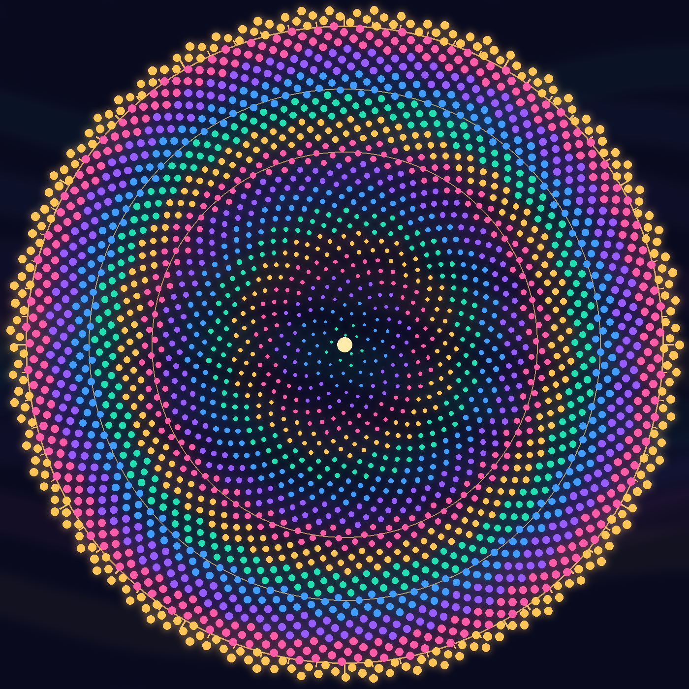

# Art #5 — "Phyllotaxis Meridian" (make-art-aiprove entry by noir)

A golden-angle phyllotaxis bloom of 2,600 florets, coloured by radius
through the aurora palette, fused with the ledger motif of the earlier
pieces: gold record rings and 72 meridian ticks turn the bloom into a dial —
every point entered, every point on the record. The two motifs of art #3
(phyllotaxis) and art #4 (aurora) in one instrument, new seed (90210),
deterministic, generated by `make_art5.py` (Python PIL only), 2026-11-14.
